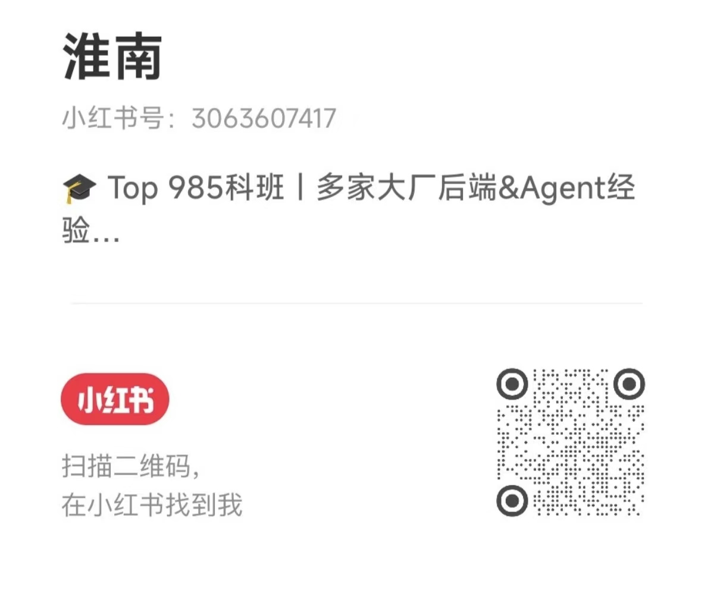

# Ecom-Service-Agent: 从0到1实战企业级电商客服Agent系统

## 求职辅导

我目前也在做 **AI 方向的求职辅导**，服务内容包括：

- 简历精修（针对 AI / Agent 岗位优化）
- 项目包装（这是最核心的，根据你过往的工作/实习和项目经历，定制化包装成agent项目，尽量多地融入agent主流技术，以及给你一份面试时口述的逐字稿）
- 模拟面试（结合你的项目经历和大厂常问的问题进行深挖）
- 全程陪跑（从投递到拿 offer）

有需要的同学可以添加我的微信：**HuaiNan54321**，备注「求职辅导」。

---

## 图解教材的原理实验

《大模型与Agent原理图解：基础、实践与进阶》的示例统一位于本仓库 `examples/`，下载这一份仓库即可跟随 PDF 操作。使用 Python 3.11+，从仓库根目录、激活后的虚拟环境运行：

```bash
python -m examples.ch01.demo
python -m examples.ch09.demo
python -m examples.appendix_c.diagnose
```

上面三个入口只用标准库，不需要 API Key。第 9 章另有可选的本地 MCP 实验，须在独立环境安装相应依赖。完整入口、三种可选依赖、显式 `--live` 配置与系统边界见 [examples/README.md](examples/README.md)。实验使用 `AGENTBOOK_*` 环境变量且不自动读 `.env`；下面的主应用使用 `OPENAI_*` / `MODEL_NAME` 配置，运行对话和评测可能调用真实模型。

在 `main.py` 里可以直接办理教学订单的退款。客服登记待确认请求，聊天程序核对用户确认，最终结果写进本地订单账本。想观察「提交成功后恰好断线」的内部步骤，可以再跑第 22 章的故障注入脚本。脚本使用 A1001 等实验订单，主客服使用 ORD 开头的订单。主系统 MCP v1 与第 9 章的 MCP v2.3 实验使用各自的虚拟环境。

---

## 快速开始（Quick Start）

跑起来只需要一个 OpenAI API Key，5 分钟即可看到「小夕」上线对话。

```bash
# 1. 进入项目并创建虚拟环境（Python 3.11+）
cd ecom-service-agent
python3.11 -m venv .venv && source .venv/bin/activate

# 2. 安装依赖
pip install -r requirements.txt

# 3. 配置 API Key
cp .env.example .env
# 编辑 .env，至少填入：
#   OPENAI_API_KEY=sk-你的key
#   （可选）OPENAI_BASE_URL=https://... 如用中转/代理
#   （可选）MODEL_NAME=gpt-4o-mini

# 4. 构建知识库索引（RAG 检索需要，首次运行一次即可）
python -m app.scripts.build_kb_index

# 5. 启动对话
python main.py
```

启动后直接输入问题即可，试试这些：

- `我的订单还没发货，怎么回事？` —— 触发订单 + 物流查询
- `有没有宽松透气的裤子推荐？` —— 触发商品推荐技能
- `这件衣服质量有问题，我要退货` —— 触发退货退款流程

每条回复底部会显示 `[意图 | 置信度 | 是否转人工]`。对话中还支持这些命令：

| 命令 | 作用 |
|------|------|
| `skills` | 查看已加载的技能模块 |
| `memory` | 查看短期 / 长期记忆 |
| `reset` | 清空当前会话 |
| `quit` / `exit` | 退出 |

**在聊天里办一笔退款**

在 `.env` 设置 `MEMORY_USER_ID=小红`，启动 `python main.py`。小红有一笔未发货的 1828.90 元教学订单。输入「帮我给 ORD-20240120-002 申请退款，原因是不想要了」。客服显示订单、金额、原因和请求号后，输入 `quit` 退出，再用相同配置重启。启动时会看到待确认的草案，也可以输入 `退款进度 <请求号>` 查看（把占位符换成客服给你的编号）。

输入客服给出的 `确认退款 <请求号>` 后，账本会登记这笔申请，状态变为「退款处理中」。重复发送同一条确认命令，仍可查回原申请。想在确认前放弃，输入 `取消退款 <请求号>`。这些操作读写会话文件同目录的 `refunds.sqlite3`，单客服和多客服共用教学订单账本。

如果是从旧版升级，原来的 `app/sessions/session.json` 可能没有顾客标识。程序会将这份历史保留在原位置，为当前顾客另开会话。从新版开始，会话快照会记下 `MEMORY_USER_ID`，换回同一顾客就能接着聊。长期记忆保存在 `app/sessions/memory/users/`，文件名取顾客标识的 SHA-256。已有的 `memory/小红.json` 等旧文件，在文件内 `user_id` 与当前顾客相符时仍可读取。

**开启进阶能力**（可选，改 `.env` 后重启即可）：

- `MULTI_AGENT_ENABLED=true` —— 多 Agent 协作（售前/售后/投诉分流）
- `MCP_ENABLED=true` —— 启用 MCP 工具服务（另起 `python mcp_server/server.py`）。主聊天中的订单、物流和退款仍由绑定当前顾客的本地账本处理。
- `RAG_BACKEND=chroma` —— 换用 Chroma 向量数据库（需 `pip install chromadb`）

**跑评估 & 测试**：

```bash
python -m app.scripts.run_eval        # 批量评估；被测 Agent 仍调用模型，--no-judge 只关闭裁判
python -m examples.ch20.demo --output runs/ch20.json   # 离线比较两种固定策略，核对业务状态
python -m examples.ch19.judge --output runs/ch20-judge.json   # 用同一笔退款练习核对文本与代码两种判定
python -m app.scripts.run_eval --mode single --compare-bare --no-judge --output runs/live-comparison.json
pytest                                # 运行全部单元测试
```

最后一条评测命令需要配置模型。它给无工具基线和实际单 Agent 相同的模型、用户消息及任务，各自从新会话开始。模型是否能访问本地订单工具，就是两套系统的能力差异之一。每题首次尝试的答复按预先指定的意图、关键词覆盖率、转人工标记计分。报告列出每条规则的覆盖题数，以及具体哪些题新通过、哪些题退步。单次异常留在分母并单列；若大量请求因模型服务出错，先处理配置再看通过率。

平均工具调用、每题耗时和聊天模型 token 单列对照。token 根据对话接口返回的 usage 汇总，不含检索的嵌入调用；任何题缺少完整用量，整组 token 均值就记为 null，并报告完整记录题数。需要核对“退款申请是否实际写入”，可运行上面的离线实验，查看同一笔订单在执行前后的状态。

### 从主客服的评测记录改进下一轮对话

先跑当前客服，再让程序从实际失败的题中提出一条候选规则。例如，一条要求查系统记录的题里客服没查就答，候选可以是“先调用相应查询工具，再回答具体事实”。候选文字从代码维护的规则清单中选择。顾客原话、差评和工具返回都不会直接写进下次对话的系统提示词。

下面以默认单客服为例，在仓库根目录运行。若曾打开多客服，先在 `.env` 设 `MULTI_AGENT_ENABLED=false`。

```bash
python -m app.scripts.run_eval --mode single --no-judge --output runs/dev.json
python -m app.scripts.evolve propose --mode single --report runs/dev.json
python -m app.scripts.evolve validate --mode single --report runs/dev.json --output runs/validation.json
```

第一条和第三条会使用你配置的聊天模型。如果已有旧版评测报告，请先用第一条命令重跑，新报告会记录当前客服的模型、评测阈值和策略版本。`propose` 找出能解释最多失败题的一条规则。`validate` 让当前客服和加了这条规则的客服各做一遍 4 道新题，核对家电订单、查询吸尘器续航、处理投诉转人工、回应普通问候。

两边每道题都从新会话开始，使用本地工具，关闭跨会话记忆和 MCP。若没有匹配的失败，或对照中出现运行错误、已通过题退步、总通过数没有增加，就保留当前版本。如果已经拿这 4 题反复调过规则，给 `validate` 加 `--holdout <用例文件>`，换一批尚未用过的工单，格式与主系统 `app/evaluation/cases.json` 一致。

打开 `runs/validation.json`。验证通过时会看到 `eligible: true` 和版本号，`paired.improved` 列出新答对的题，`paired.regressed` 列出从对变错的题。决定采用时，把下面示例中的 `1` 换成报告给出的 `version`。下次启动客服，模型收到的系统提示里就有这条规则。

```bash
python -m app.scripts.evolve adopt 1 --mode single
python -m app.scripts.evolve status --mode single
python main.py
```

要撤回刚才的版本，运行 `python -m app.scripts.evolve rollback 1 --mode single`，同样把 `1` 换成要撤回的当前版本号。策略状态默认保存在 `app/sessions/policy.sqlite3`，可通过 `POLICY_DB_PATH` 指定位置。验证和聊天请使用相同的客服模式、模型、服务地址和温度。多客服使用相同流程，开发评测和策略命令都传 `--mode multi`，聊天时设置 `MULTI_AGENT_ENABLED=true`。

---

## 背景

大家好，我是淮南，Top 985科班出身，有多家大厂后端 & AI Agent 研发经验。

我在小红书上运营着一个 **AI Agent 面经系列**，分享了我面试字节、阿里、MiniMax 等多家公司 AI Agent 岗位的真实面经，目前已经积累了 5000+ 粉丝。在和大家交流的过程中，我发现很多同学对 Agent 相关技术很感兴趣，但苦于没有一个**完整的、可跟着动手的实战项目**。

所以我决定做这件事 —— **以电商客服为场景，从0到1带大家实战一个企业级 Agent 系统**。

### 为什么选电商客服？

电商客服是 Agent 最经典的落地场景之一：业务逻辑清晰（查订单、退换货、推荐商品、售后处理），大家容易理解，面试中也经常被问到。做完这个项目，你不仅能掌握 Agent 核心技术栈，还能直接写进简历。

### 更新方式

我会在小红书上**每期更新一个 Agent 相关技术**，对应本仓库的一个 commit / tag。特别复杂的技术点会拆成 2 期。你可以跟着每期笔记，checkout 到对应的 tag，一步一步跟着做。

**扫码关注我的小红书，获取每期更新通知：**

<p align="center">
  
</p>

### 技术演进路线（更新预告）

本项目会按照由浅入深的节奏，逐步叠加 Agent 相关技术：

**基础篇**
- 纯 Prompt 实现客服对话
- 结构化输出（Structured Output）
- 多轮对话管理

**进阶篇**
- ReAct 范式的 Agent（思考-行动交替，最经典的 Agent 范式）
- 工具调用 / Function Calling（查订单、查库存等）
- MCP（Model Context Protocol）集成
- RAG 检索增强生成（接入商品库、FAQ、退换货政策等）

**高级篇**
- Multi-Agent 协作（客服路由、售前售后分流）
- Memory：短期记忆 & 长期记忆
- Skill：可复用的能力模块（退货处理、订单跟踪等标准化流程）✅
- Agent 评估体系 ✅
- 退款申请确认、跨进程查回与重复确认处理
- 从客服评测报告生成候选策略，验证后采用或回滚

**生产篇**
- Guardrails 安全护栏（Prompt Injection 检测、输出幻觉校验、敏感信息过滤、意图越界拦截）
- Human-in-the-Loop 人机协作（置信度评估与自动转人工、Agent↔真人客服交接协议、上下文传递）
- Agent Observability 可观测性（调用链 Trace、Token/延迟指标采集、工具成功率看板、异常告警）

> 以上为初步规划，实际更新可能会根据大家的反馈进行调整。

---

## 项目架构 & 更新历史

> 这是本项目最核心的部分，会随着每一期的更新持续完善。

### 当前架构

```
ecom-service-agent/
├── main.py                        # CLI 入口（支持单 Agent / Multi-Agent 模式切换 + memory/skills 命令）
├── requirements.txt
├── .env.example
│
├── app/                           # 主 Bot 全部代码 + 数据
│   ├── config/
│   │   └── settings.py            # 配置管理（从 .env 读取，含 MCP / RAG / Multi-Agent / Memory / Skill / Evaluation 配置）
│   ├── prompts/
│   │   ├── customer_service.py    # 电商客服 system prompt（含工具使用指南 + 记忆能力）
│   │   ├── summarizer.py          # 历史摘要 prompt
│   │   ├── agents.py              # Multi-Agent 子 Agent prompt（售前/售后/投诉 + Router）
│   │   ├── memory.py              # 记忆提取 prompt（短期 STM / 长期 LTM 事实抽取）
│   │   └── evaluation.py          # LLM-as-judge prompt（回答质量 / 幻觉 / 过程合理性）
│   ├── schemas/
│   │   └── response.py            # 结构化输出 schema（Pydantic）
│   ├── agent/                     # Agent 核心实现 + 全部 Agent 技术栈（tools / rag / skills）
│   │   ├── chat.py                # 核心 ReAct 循环（集成 MemoryManager + SkillManager）
│   │   ├── summarizer.py          # LLM 自我压缩老对话（支持工具消息）
│   │   ├── storage.py             # 会话 JSON 持久化（含短期记忆）
│   │   ├── memory/                # 记忆系统（第7期）
│   │   │   ├── __init__.py        # 导出 MemoryManager / ShortTermMemory / LongTermMemory
│   │   │   ├── manager.py         # MemoryManager：统一管理短期 + 长期记忆
│   │   │   ├── short_term.py      # 短期记忆：会话内事实提取
│   │   │   ├── long_term.py       # 长期记忆：跨会话持久化（JSON per user）
│   │   │   └── extraction.py      # LLM 事实提取（共用模块）
│   │   ├── skills/                # Skill 模块（第8期）：代码 + 技能内容分层
│   │   │   ├── __init__.py        # 导出 SkillManager / SkillMeta
│   │   │   ├── loader.py          # SkillManager：扫描、发现、加载 SKILL.md（渐进式披露）
│   │   │   └── definitions/       # 技能内容（遵循 Agent Skills 开放标准，每个一个 SKILL.md）
│   │   │       ├── process-return/
│   │   │       │   └── SKILL.md   # 退货退款处理技能（确认订单→校验资格→退款→告知进度）
│   │   │       ├── track-order/
│   │   │       │   └── SKILL.md   # 订单物流跟踪技能（查单→查物流→综合建议）
│   │   │       └── product-recommend/
│   │   │           └── SKILL.md   # 商品推荐技能（了解需求→查偏好→搜索→推荐）
│   │   ├── strategies/            # 聊天时读取已采用的客服策略
│   │   ├── tools/                 # 电商工具集（Function Calling）
│   │   │   ├── mock_data.py       # Mock 数据：订单、商品、物流
│   │   │   ├── registry.py        # 本地工具注册表 + OpenAI schema + 分发执行
│   │   │   ├── manager.py         # ToolManager：统一管理本地 + MCP 工具（支持 allowed_tools 过滤）
│   │   │   ├── order.py           # 查询订单详情
│   │   │   ├── product.py         # 搜索商品信息
│   │   │   ├── logistics.py       # 查询物流轨迹
│   │   │   ├── refund.py          # 退款草案、顾客确认和可跨进程查回的业务账本
│   │   │   ├── knowledge.py       # search_knowledge：RAG 政策/FAQ 检索
│   │   │   ├── memory_tool.py     # recall_user_memory：查询用户记忆
│   │   │   └── skill_tool.py      # load_skill：按需加载技能指令
│   │   └── rag/                   # RAG 模块
│   │       ├── chunker.py         # Markdown → Chunk（按二级标题切分）
│   │       ├── embedder.py        # OpenAI Embeddings 封装
│   │       ├── retriever.py       # KnowledgeRetriever：query → 向量检索
│   │       ├── backends/          # 向量后端（可切换）
│   │       │   ├── base.py        # VectorBackend 抽象接口
│   │       │   ├── numpy_backend.py   # 手写余弦 + JSON（教学透明，零依赖）
│   │       │   └── chroma_backend.py  # Chroma 嵌入式向量数据库（生产代表）
│   │       └── knowledge/         # 知识库源文档（markdown，RAG 数据源）
│   │           ├── 退换货政策.md
│   │           ├── 配送说明.md
│   │           ├── 会员权益.md
│   │           └── 常见问题FAQ.md
│   ├── mcp_client/                # MCP Client（同步封装）
│   │   ├── client.py              # MCPClient：后台线程管理异步连接
│   │   └── converter.py           # MCP Tool schema → OpenAI function calling 格式
│   ├── evaluation/                # Agent 评估体系（第9期）
│   │   ├── __init__.py            # 导出 EvalCase / Sandbox / Evaluator / RunTrace 等
│   │   ├── dataset.py             # EvalCase 数据结构 + load_dataset
│   │   ├── trace.py               # RunTrace：沙箱采集的过程+结果载体
│   │   ├── sandbox.py             # Sandbox：隔离环境 + 共享 client 插桩 + 采集
│   │   ├── metrics.py             # 过程/结果双层指标（代码规则 + LLM judge）
│   │   ├── evaluator.py           # Evaluator：跑用例 → 双层评分 → 聚合报告
│   │   ├── cases.json             # 开发用例（教学订单与业务咨询）
│   │   └── evolution_holdout.json # 验证候选客服规则的留出用例
│   ├── multi_agent/               # Multi-Agent 协作（第6期）
│   │   ├── router.py              # 意图路由器（LLM 分类 → 子 Agent）
│   │   ├── agents.py              # SubAgent 子 Agent 类 + 配置
│   │   └── orchestrator.py        # 编排器：路由 → 执行 → 结构化提取（集成 MemoryManager + SkillManager）
│   ├── scripts/
│   │   ├── build_kb_index.py      # 构建本地索引，嵌入可能调用 API（--backend numpy/chroma）
│   │   ├── run_eval.py            # 批量评估，被测 Agent 仍调用模型（--no-judge 只关闭裁判）
│   │   └── evolve.py              # 从失败题提取候选规则，验证、采用或回滚
│   └── sessions/                  # 运行时生成，已 .gitignore
│       ├── session.json           # 当前会话快照
│       ├── refunds.sqlite3        # 退款草案、确认状态与申请回执
│       ├── policy.sqlite3         # 已验证的提示规则版本及采用记录
│       ├── kb_index.json          # NumpyBackend 索引
│       ├── chroma/                # ChromaBackend 持久化目录
│       └── memory/users/          # 长期记忆存储（按 user_id 分文件）
│           └── {sha256}.json
│
├── mcp_server/                    # MCP Server（独立微服务）
│   └── server.py                  # FastMCP + Streamable HTTP，暴露电商工具
│
└── tests/                         # 全部测试
    ├── test_agent.py              # 结构化输出 + 多轮 + reset
    ├── test_conversation_management.py  # 多轮对话管理
    ├── test_react_agent.py        # ReAct Agent + Function Calling
    ├── test_mcp.py                # MCP 集成
    ├── test_rag.py                # RAG 知识库检索
    ├── test_multi_agent.py        # Multi-Agent 协作
    ├── test_memory.py             # Memory 短期记忆 & 长期记忆
    ├── test_skills.py             # Skill 可复用能力模块
    └── test_evaluation.py         # Agent 评估体系（沙箱 + 双层测评）
```

### 更新日志

| 期数 | 主题 | Tag | 日期 |
|------|------|-----|------|
| 第 1 期 | 项目框架 + 纯 Prompt 客服 + 结构化输出 | v1-prompt-and-structured-output | 2025-04-14 |
| 第 2 期 | 多轮对话管理：Summary 压缩 + JSON 持久化 | v2-conversation-management | 2026-04-18 |
| 第 3 期 | ReAct Agent + 工具调用 (Function Calling) | v3-react-and-function-calling | 2026-04-27 |
| 第 4 期 | MCP 集成 (Streamable HTTP) | v4-mcp-integration | 2026-05-01 |
| 第 5 期 | RAG 检索增强生成（FAQ + 政策知识库） | v5-rag | 2026-05-13 |
| 第 6 期 | Multi-Agent 协作（客服路由 + 售前/售后/投诉分流） | v7-multi-agent | 2026-05-17 |
| 第 7 期 | Memory：短期记忆 & 长期记忆 | v8-memory | 2026-05-23 |
| 第 8 期 | Skill：可复用能力模块（基于 Agent Skills 开放标准） | v9-skills | 2026-05-31 |
| 第 9 期 | Agent 评估体系（沙箱重跑测试集 + 过程/结果双层指标 + LLM judge） | v10-evaluation | 2026-06-06 |

> 每期更新后，这里会同步更新架构图和更新日志。
